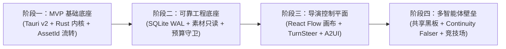

# Meocox Flow 架构勘探与演进式重构诊断书 (REFACTOR_PLAN.md)

> **勘探执行者**：`legacy-spec-miner` 只读勘探与架构诊断子智能体  
> **勘探基线**：根目录 `AGENTS.md`《2026 AIGC 六层架构蓝图与三大铁律》 & `ARCHITECTURE_STATE.md`  
> **勘探时间**：2026-10-16  
> **目标工程**：`d:\apps\meocox-flow`

---

## 一、 当前工程技术栈测绘与架构拓扑诊断

经全局源码扫描与进程测绘，当前 `meocox-flow` 的真实架构形态呈现高度的**“底座倒置”**与**“双轨分裂”**特征。

### 1.1 实际技术栈与拓扑现状

```mermaid
flowchart TD
    subgraph CurrentTopology ["当前实际工程拓扑 (Legacy Topology)"]
        subgraph Host ["桌面壳层 (src-tauri)"]
            TauriHost["Tauri v2 (Rust 仅 500 行)"]
            TauriHost -->|spawn 子进程| SeaBackend["Node.js SEA (meocox-backend.exe)"]
            TauriHost -->|强行 kill| Destroy["WindowEvent::Destroyed 杀死后端"]
        end

        subgraph ClientPlane ["前端控制平面 (client/)"]
            ReactUI["React 19 (纯 JSX, 0% TypeScript)"]
            Vite["Vite 8.3 + Tailwind v4"]
            ReactUI -->|HTTP / SSE (localhost:3001)| ExpressServer
            ReactUI -.->|未接入| NoFlow["无 @xyflow/react 画布"]
            ReactUI -.->|死代码| DeadApi["runsApi / blackboardApi (零引用)"]
        end

        subgraph BackendPlane ["后端服务 (server/) - 端口 3001"]
            ExpressServer["Express 5 + ESM"]
            ThreadRunner["threadTurnRunner.js (业务主循环)"]
            EngineTrack["server/src/engine (业务引擎)"]
            CoreTrack["server/src/core (并立未接通的黑板/调度内核)"]
            Storage["server/src/storage (1309 行 JSON 散落读写 + 内存锁)"]
            ExpressServer --> ThreadRunner
            ThreadRunner --> EngineTrack
            EngineTrack --> Storage
            CoreTrack -.->|断头路未通| DeadCore["独立 blackboard/policy/primitives"]
        end
    end
```

### 1.2 源码规模与实现程度统计

| 目录/模块 | 文件数 / 代码规模 | 实际技术栈 | 实现程度与真实状态 |
| :--- | :--- | :--- | :--- |
| **`src-tauri/`** | 2 个核心源码文件 (`lib.rs`, `main.rs`)，约 520 行 | Rust (Tauri v2.12) | **外壳启动器**：未承载任何业务状态机或媒体管线，仅负责探测并以子进程方式启动 Node.js SEA 产物 (`meocox-backend.exe`)，窗口销毁时粗暴强杀子进程。 |
| **`client/`** | 80+ 个组件与库文件 | React 19.3 + Tailwind v4 + Radix UI + Vite 8.3 | **全量纯 JavaScript (`.jsx` / `.js`)，0 TypeScript**：无类型安全契约；缺少 `@xyflow/react` 节点图；缺少 `Yjs` 双向同步；通信完全依赖 HTTP/SSE 轮询 `localhost:3001`。 |
| **`server/`** | 100+ 个文件，约 50,000+ 行代码，54 个测试套件 (368 个测试全绿通过) | Node.js 22 + Express 5 + Remotion 4 | **单体庞杂后端**：实现了较为完整的模型调用网关、分镜生成、剪映草稿导出与提示词清洗，但状态全依赖散落磁盘的 JSON 文件，且存在两套并立的调度引擎。 |
| **`agents/`** | 8 个专职智能体定义目录 (`agent.md` + `agent.yml`) | Markdown + YAML | **成熟度极高**：定义了 `super-brain`、`code-motion-engineer`、`motion-director`、`perception-specialist`、`render-officer`、`sound-designer`、`voice-scout`、`evolution-specialist`，具备清晰的 Mode 0/1/2 分级与红线意识。 |
| **`skills/`** | 12 个领域技能规约目录 (`SKILL.md`) | Markdown (Frontmatter) | **成熟度极高**：沉淀了完整的系统自检规约、Remotion 最佳实践、音频音效指导、多模态内容感知等专业 SOP。 |
| **`mcp_servers/`** | 1 个独立项目 (`google-flow-mcp`) | TypeScript + `@modelcontextprotocol/sdk` + SQLite | **成熟可用**：完整的 Google Flow 浏览器自动化 MCP 服务，支持 22 个标准 MCP 工具与本地状态持久化。 |
| **`tools/`** | 0 个文件 | 空目录 | **死目录**：预留目录，未存放任何可执行工具。 |
| **`mock/`** | 4 个 JSON 文件 | JSON | **纯演示死数据**：供 demo 模式伪造能力和配置。 |

---

## 二、 高价值可复用资产（Reuse）深度盘点

以下资产经过深度业务打磨和单元测试验证（测试集 368 项全绿通过），具有极高的业务与逻辑价值，重构时必须**完整清洗保留并按新契约移植**：

| 资产编号 | 资产名称与文件精确路径 | 核心功能与业务价值 | 在 2026 新架构中的复用 / 清洗建议 |
| :--- | :--- | :--- | :--- |
| **GEM-01** | **剪映/CapCut Pro 工业级草稿组装引擎**<br>`file:///d:/apps/meocox-flow/server/src/services/jianying.js` (776 行) | 完整解析并构建剪映专业版工程格式（`draft_content.json` / `draft_meta_info.json`），精准映射视频轨、音频轨、字幕轨、微秒级时间戳（`toUs`）、缓动曲线与画中画变换。 | **清洗移植至 Rust 批处理媒体管线**：将该 JS 算法重构为 Rust 强类型结构体（配合 `serde_json`），作为第四层确定性导出管线工具，彻底脱离 Node.js。 |
| **GEM-02** | **纯数学零依赖程序化音效合成器**<br>`file:///d:/apps/meocox-flow/server/src/services/proceduralAudioService.js` (148 行) | 基于 16-bit PCM 原生采样生成商业免版税音效：转场嗖声（Whoosh）、提示音（Chime/Ding）、低频撞击（Impact Thud）、赛博故障声（Cyber Glitch）。无需外部素材，零网络开销。 | **极速移植至 Rust**：Rust 原生生成 PCM WAV 缓冲只需数十行代码，性能提升数十倍，作为确定性 ACI 原子工具直接集成。 |
| **GEM-03** | **通用流式与思维链增量解析器**<br>`file:///d:/apps/meocox-flow/server/src/engine/model/streamParser.js` (248 行) | 工业级流式解析器，支持 DeepSeek 官方 API `delta.reasoning_content`、Ollama 拆分分片 `<think>` 标签、Claude `<thinking>` 标签捕获与清洗，以及 `tool_calls` 碎片合并。 | **移植至 Rust 流式通道**：在新架构 Rust 端（`tauri::ipc::Channel`）做流式解析过滤，确保前端仅接收结构化的思考流与正文流。 |
| **GEM-04** | **剧组专职角色人设与战略提示词体系**<br>`file:///d:/apps/meocox-flow/agents/*/agent.md` & `agent.yml` (8 套) | `super-brain` 意图分级（Mode 0/1/2）、防断层精炼上下文打包（Lean Packaging）、`perception-specialist` 事实卡片提取、`code-motion-engineer` 动效编排等。已被多轮实测验证。 | **100% 原样保留**：作为第三层剧组专职角色核心 Prompts，仅需将其中的绝对路径参数调整为新架构的 `AssetId` (UUIDv7) 句柄。 |
| **GEM-05** | **标准领域技能规约 SOP 库**<br>`file:///d:/apps/meocox-flow/skills/*/SKILL.md` (12 套) | 包含《系统扩展合规自检清单规约》、《Remotion 编码规范》、《视听感知 SOP》、《音频音效指导》等，格式严格遵循 Frontmatter 规范。 | **100% 原样保留**：直接挂载至新架构第四层三级渐进式披露技能库中。 |
| **GEM-06** | **Google Flow 浏览器自动化 MCP 服务**<br>`file:///d:/apps/meocox-flow/mcp_servers/google-flow-mcp/` | 完整的本地 MCP 服务器，支持无缝驱动 Chrome/Edge 浏览器完成项目追踪、登录辅助、媒体生成准备、确认与本地落盘验证。具备 22 个 MCP 工具和 SQLite 状态。 | **保留为独立 MCP 进程**：新架构在第四层通过官方 Rust MCP SDK（`rmcp`）挂载该服务，零改造直接调用。 |
| **GEM-07** | **前端控制台交互与 A2UI 卡片布局设计**<br>`file:///d:/apps/meocox-flow/client/src/components/stream/HITLDecisionCard.jsx`<br>`file:///d:/apps/meocox-flow/client/src/components/stream/ArtifactSidebar.jsx`<br>`file:///d:/apps/meocox-flow/client/src/components/workspace/NewWorkspace.jsx` | 优秀的侧边栏折叠、双栏响应式布局、HITL 人机决策卡、Mention 素材标注语法（`@视频1`）、产物预览抽屉。 | **重写移植为 React 19 + TypeScript (`.tsx`) + Tailwind**：保留其 UI 样式与交互设计，接入 `shadcn/ui` 与 `tauri-specta` 生成的强类型契约。 |
| **GEM-08** | **分级模型路由器与本地/云端网关**<br>`file:///d:/apps/meocox-flow/server/src/services/ai/modelGateway.js` | 优雅地区分 `installed`（本地端侧小模型如 llama.cpp / whisper）与 `api`（云端商用大模型），支持动态回退与配置解析。 | **重构为 Rust 端分级模型路由器**：下沉至 Rust 第二层编排中枢，由 Rust 控制密钥注入与端云分流。 |

---

## 三、 对照六层架构与铁律：核心病灶深度诊断（Refactor）

### ❌ 病灶 1：上下文与 IPC 严重二进制污染（违反铁律三：句柄流转铁律）
- **具体文件**：
  - `server/src/services/perception/analyzers/imageAnalyzer.js`（第 23-28 行）：直接 `fs.readFile` 读取图片，转为 `data:${mimeType};base64,...` 塞进 LLM 对话消息数组；
  - `server/src/services/perception/analyzers/videoAnalyzer.js`（第 175-179 行）：提取 2 帧视频关键帧后转为 Base64 拼入 Prompt；
  - `server/src/services/videoPerception.js`（第 226-235 行）：直接将关键帧 Base64 塞进 ChatCompletion 请求体；
  - `server/src/index.js`（第 56-57 行）：为承受大图片流转，强行将 Express 请求体限制提高至 `50mb`；
  - `client/src/lib/apiClient.js`（第 67-70 行）：媒体预览直接拼接带有磁盘绝对路径的 HTTP URL（`/api/assets/stream?path=...`），前端直接暴露操作系统裸路径。
- **系统危害**：
  Base64 极度消耗上下文 Token 并导致网络延迟飙升数十倍；操作系统物理裸路径在网络传输中极易受路径遍历注入攻击，完全违背“全链路句柄流转（Handle-Only Context）”与零拷贝预览铁律。

### ❌ 病灶 2：脑壳严重倒置、进程强杀与无后台守护（违反铁律二：守护进程优先）
- **具体文件**：
  - `src-tauri/src/lib.rs`（第 498-506 行）：
    ```rust
    .on_window_event(|window, event| {
        if let tauri::WindowEvent::Destroyed = event {
            if window.label() == "main" {
                shutdown_backend(window.app_handle());
            }
        }
    })
    ```
- **系统危害**：
  1. **脑壳倒置**：Rust 仅沦为“Node.js 启动器”，核心状态机与计算全部塞在单线程 Node.js 进程中；
  2. **强杀丢进度**：用户一旦误关前端窗口，Tauri 立即在 `Destroyed` 事件中调用 `shutdown_backend`，通过 Job Object 硬杀后端进程。后台正在进行的 4K 视频渲染、模型下载或 AI 批处理瞬间中断夭折；
  3. **缺乏托盘接管**：未实现 `RunEvent::ExitRequested` 拦截与系统托盘（System Tray）守护，无法做到“关窗口释放 WebView 显存，后台持续渲染”的伪守护模式。

### ❌ 病灶 3：工作流与状态深度撕裂（违反反模式禁令：禁止状态撕裂）
- **具体文件**：
  - `server/src/storage/index.js`（1309 行）：全系统状态采用散落的本地 `.json` 文件存储（如 `projects/<id>/storyboard.json`, `tasks.json`, `threads.json`），依靠内存中的 `fileLocks = new Map()` 实现伪并发锁；
  - `client/src/components/Storyboard.jsx`：仅是一个简单的竖向卡片列表，完全缺少 `@xyflow/react` 节点图，也无非线性多轨时间轴；
  - 全局代码中完全缺失 OTIO 快照与 Yjs/CRDT 协同状态。
- **系统危害**：
  一旦 Node.js 进程在写入中间异常退出，JSON 文件极易损坏或出现空文件；多进程无法共享内存锁；缺乏基于原子检查点（Checkpoint）的状态时光机，无法支持一键回滚（Revert）与平行分叉（Fork）。

### ❌ 病灶 4：缺乏知觉证伪者与预算硬性护栏（违反反模式禁令：禁止无证伪裸奔）
- **具体文件**：
  - `server/src/core/policy/qualityGate.js` & `server/src/core/policy/budget.js`：仅作为孤立函数存在，未接入真实执行循环；
  - `server/src/services/threadTurnRunner.js`：生成完素材后无任何一致性审查直接交付。
- **系统危害**：
  系统没有独立的 `Continuity Falser`（连贯性证伪者）刺探视频跳轴、面部漂移与音画不同步；没有 `Quota Guardian`（预算守卫）在批量调用高成本云端 API 前进行费用估算与强制挂起（`interrupt`），极易导致用户账单失控。

### ❌ 病灶 5：断头路与双轨分裂系统（未连通的核心模块）
- **具体文件**：
  - `server/src/core/` 目录（共 28 个核心文件，包括 `blackboard/store.js`, `contracts/`, `primitives/`, `scheduler/runtime.js`）；
  - `server/src/routes/runs.js`, `primitives.js`, `projections.js`, `blackboard.js`；
  - `client/src/lib/blackboardApi.js`, `runsApi.js`, `primitivesApi.js`, `projectionsApi.js`。
- **系统危害**：
  经过全文交叉引用排查，前端 UI（`NewWorkspace.jsx`）实际上是通过 `projects.js` 和 `threadTurnRunner.js` 运转的，而整套 `server/src/core/` 与其配套路由完全是一套**并立且未接通的半成品断头路**！前端 `client/` 中虽然写了对应的 API 封装，但没有一个 React 组件实际调用它们。

---

## 四、 废弃与死代码清单（Deprecate）

重构过程中，以下模块与文件明确列为**废弃死代码，坚决不予迁移**：

1. **硬编码 Mock 剧本与演示接口**：
   - `server/src/engine/mock/scenarioRunner.js`（448 行：硬编码艾米、维克多、诺亚的 fake sleep 演示脚本）
   - `server/src/engine/mock/interceptor.js` & `protocol.js`
   - `mock/` 根目录下的所有模拟 JSON 文件（`capabilities.json`, `config.json`, `default.json`, `system_info.json`）
2. **孤立的前端断头路 API 客户端**：
   - `client/src/lib/blackboardApi.js`（零组件引用）
   - `client/src/lib/runsApi.js`（零组件引用）
   - `client/src/lib/primitivesApi.js`（零组件引用）
   - `client/src/lib/projectionsApi.js`（零组件引用）
3. **脆弱的散落 JSON 存储与迁移脚本**：
   - `server/src/storage/index.js`（1309 行散落读写逻辑，直接被 SQLite WAL 取代）
   - `server/src/storage/migrate.js`（针对旧版 JSON 目录结构的迁移脚本）
   - `scripts/migrate-videos-projects.js`
4. **冗余的 Windows 外部脚本探测器**：
   - `server/src/utils/folderPicker.ps1` & `pickFolder.ps1`（直接使用 Tauri 原生 `tauri-plugin-dialog` 取代）
5. **空壳未实现目录**：
   - 根目录下空的 `tools/` 与 `tests/`

---

## 五、 重构路径终局抉择：绞杀榕 vs. 净室剥离

这是决定项目重构生死与研发效率的最核心决策点。

### 5.1 方案深度对比矩阵

| 评估维度 | 路径 A：绞杀榕渐进重构 (Strangler Fig) | 路径 B：净室剥离移植 (Clean-Room Extraction) 🏆 |
| :--- | :--- | :--- |
| **重构逻辑** | 在旧代码库内“修桥补路”：保留 Node.js SEA 和当前 JSX 前端，在 `src-tauri/` 中逐步用 Rust Command 替换旧 Express 路由。 | 按照 `00-bootstrap-project.md` 建立纯净新工程：以 Rust 为真正后端底座，React 19 + TypeScript 为前端，将旧库中的高价值资产清洗迁入。 |
| **底座腐化克服** | **极度困难**。旧底座存在“Tauri 包 Node.js SEA”的严重脑壳倒置，且前端为 100% 纯 JSX，无法直接利用 `tauri-specta` 生成强类型 TS 契约。必须同时维护 Node 进程、端口占用与 Rust 运行时。 | **彻底根治**。第一天即确立 Tauri v2 + Rust 为单一原生宿主，彻底剔除 Node.js SEA 运行时及 50MB HTTP 中转。 |
| **类型安全与契约** | **脱节**。前端为无类型的 `.jsx`，若想渐进改造，必须边改接口边推导类型，极易在两端出现契约漂移。 | **原生强类型**。前端从一开始即锁定 TypeScript (`.tsx`)，跨进程完全由 `tauri-specta` 自动导出 TS 类型，零手动类型定义维护。 |
| **多模态与 IPC 性能** | **无法享受零拷贝**。前端仍通过 `fetch(localhost:3001)` 传输数据，大体积音视频依然要走 HTTP 流式传输，无法使用 Tauri `asset://` 协议。 | **原生零拷贝极致性能**。Rust 原生注册 `asset://` 协议，音视频预览直接零 IPC 拷贝映射磁盘文件，UI 丝滑流畅。 |
| **开发与维护复杂度** | **极高（科学怪人架构）**。需要同时调试 Rust 编译、Node.js SEA 构建（esbuild + postject）、Tauri 启动链，一旦端口冲突或进程死锁排查成本极高。 | **清晰敏捷**。仅有标准的 Rust + Vite 双进程（开发态），生产态单二进制分发，无外部 Node 运行时依赖。 |
| **工期与交付风险** | **周期长、反复暴雷**。旧代码中的 Base64 隐蔽调用、散落的 JSON 文件锁、断头路代码会持续污染重构过程。 | **短平快、收益确定**。旧项目高价值资产边界清晰（Prompts、SOPs、CapCut JSON 算法、PCM 音效），按需清洗迁入，风险完全可控。 |

### 5.2 决绝拍板建议与核心依据

> [!IMPORTANT]
> **拍板决策：坚决采纳【路径 B：净室剥离移植 (Clean-Room Extraction)】**

**核心拍板依据**：
1. **旧底座存在不可调和的技术栈违背**：AGENTS.md 第一条红线明确锁定技术栈为 `Tauri v2 + Rust (tokio) + tauri-specta + React 19 + TypeScript`。而旧项目后端实际上是一个巨大的 Node.js SEA 进程，前端全部为无类型的 JSX。在无类型的旧底座上实施绞杀榕，无法建立 `tauri-specta` 强类型契约，无异于“在流沙上建大厦”。
2. **资产具备高度的“自包含”与“高内聚”特性**：经过本次勘探，旧项目中真正宝贵的价值（CapCut 剪映草稿算法、程序化音效、流式解析器、8 套智能体人设与 12 套技能规约）均为**纯算法、纯文本或纯 SOP**，完全不依赖旧 Express 框架。净室剥离这些“钻石级资产”并用 Rust / TS 重构，工作量仅需数天，但收益是一座干净、纯粹、毫秒级响应的现代化工程。
3. **消除双轨断头路的历史包袱**：旧项目中 `server/src/core/`（28个文件）与 `server/src/engine/` 并立分裂的悲剧，正是此前试图“在旧系统上修修补补”留下的畸形产物。净室移植允许我们以统一的 SQLite WAL 单项目数据库彻底终结这一混乱。

---

## 六、 四阶段演进式改造切片路线图（MVP → 生产级）



### 阶段一：MVP 基础底座（打通“脑壳分离”与 `AssetId` 句柄流转最小闭环）
- [ ] **Step 1.1**：基于 `00-bootstrap-project.md` 初始化全新纯净工程骨架：`Tauri v2 + Rust (tokio)` 后端 + `React 19 + TypeScript + Vite + Tailwind CSS` 前端；
- [ ] **Step 1.2**：接入 `tauri-specta` 与 `specta`，在 `src-tauri/src/orchestrator/types.rs` 中立起 `AssetId` (强制开启 UUIDv7 特性) 与基础契约；
- [ ] **Step 1.3**：在 Tauri 中拦截 `RunEvent::ExitRequested` 并配合系统托盘（System Tray）落地真正的“守护进程伪守护模式”；
- [ ] **Step 1.4**：实现自定义 `asset://` 协议与本地媒体存储池，打通“导入素材 → 生成 `AssetId` → 前端零拷贝预览”最小闭环；
- [ ] **Step 1.5**：将 `streamParser.js` 移植为 Rust 流式通道解析器，清洗迁入 `agents/super-brain`，跑通单智能体流式对话。

### 阶段二：可靠工程底座（素材只读防线、时间轴快照与 Quota Guardian）
- [ ] **Step 2.1**：使用 `rusqlite` 实现单项目独立 SQLite 数据库（启用 WAL 模式），彻底替换旧项目散落的 1309 行 JSON 存储；
- [ ] **Step 2.2**：在 Tauri FS Scope 中将用户原始素材锁定为只读（Raw Asset Immutability），实现衍生资产虚拟分离；
- [ ] **Step 2.3**：将 `jianying.js`（GEM-01）与 `proceduralAudioService.js`（GEM-02）移植为 Rust 确定性批处理工具；
- [ ] **Step 2.4**：接入算力预算守卫（Quota Guardian）与基于持久化检查点的 `interrupt()` 挂起-审批-恢复状态机。

### 阶段三：导演控制平面（双栏画布、TurnSteer 切轨与 A2UI 卡片）
- [ ] **Step 3.1**：在前端引入 `@xyflow/react`，构建双栏分镜 DAG 节点画布；
- [ ] **Step 3.2**：移植并重构旧项目优秀的交互组件（`ArtifactSidebar.jsx`、`HITLDecisionCard.jsx`），升级为标准的 `shadcn/ui` + TypeScript 组件；
- [ ] **Step 3.3**：实现生成中途无损切轨（TurnSteer），支持在长耗时媒体生成中注入高优先级控制帧；
- [ ] **Step 3.4**：打通前端 Yjs 与 Rust 端 `yrs` 的双向无锁状态同步。

### 阶段四：工业级多智能体壁垒（剧组共享黑板、知觉证伪者与竞技场）
- [ ] **Step 4.1**：在 Rust 端建立多模态共享黑板（Blackboard），挂载 8 套专职剧组角色人设（GEM-04）；
- [ ] **Step 4.2**：实现知觉连贯性证伪者（Continuity Falser），在影子工作区对生成成片执行视听挑刺与自动局部重绘；
- [ ] **Step 4.3**：接入外部 `google-flow-mcp`（GEM-06）以及第四层三级渐进式技能库（GEM-05）；
- [ ] **Step 4.4**：开启审美变体竞技场（Battle Mode）与跨会话异步审美偏好提炼，完成向工业级 AIGC 创意操作系统的全面跃迁。

---
*本重构计划书已按《2026 AIGC 六层架构蓝图》全面核实，待主智能体与用户拍板后立即启动阶段一。*
